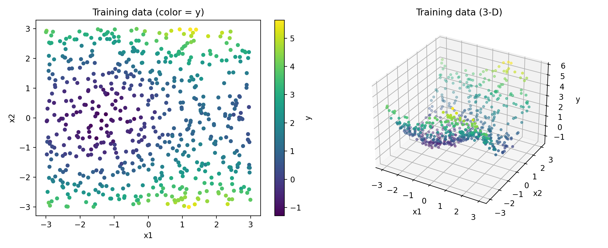
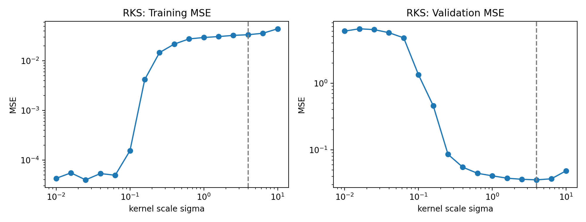
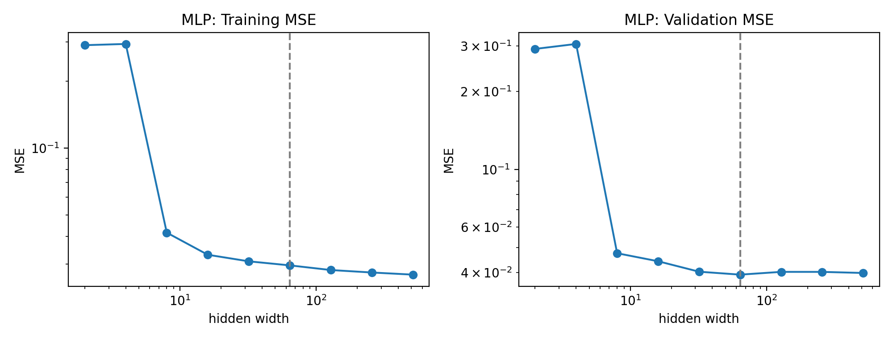
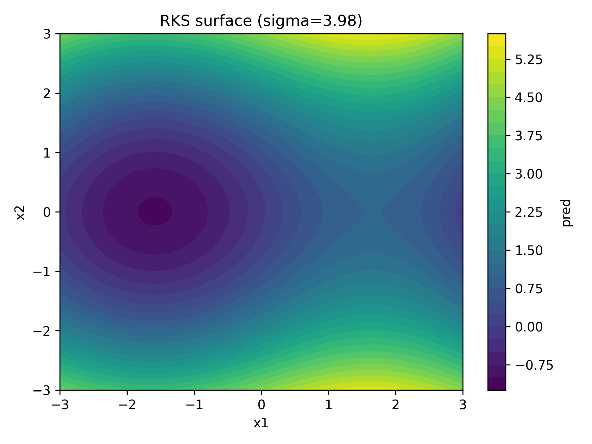
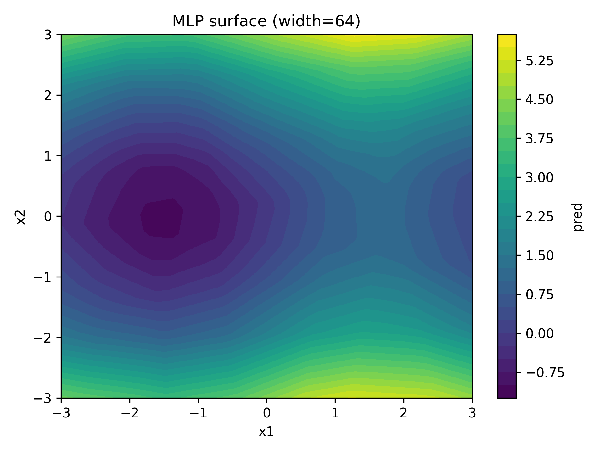

# Homework 2

## Problem 1

### (a) Link functions
Suppose the network $g$ output $g_1$ and $g_2$ $\in \mathbb{R}$, and weneed to find the link function of each that map the $g$ to $f$.

$f_\mu(x) = E[Y \mid X=x]$ is the conditional mean of target $Y$ given $X$, which should be the real number. So the link function can be just as simple as $f_\mu(x) = g_1(x)$

$f_\sigma(x)=\sqrt{\mathrm{Var}(Y \mid X=x)}$ is the conditional standard deviation of $Y$ given $X$, which is strictly positive. The link function should be able to map $\mathbb{R} \to (0,\infty)$, which can be $f_\sigma(x) = e^{g_2(x)}$ and $f_\sigma(x) = \log(1 + e^{g_2(x)})$.
The latter one is more smooth when $x$ get larger. 

The link function is $f_\mu(x) = g_1(x)$ and $f_\sigma(x) = \log(1 + e^{g_2(x)})$. 

### (b) Loss function
$Y \mid X \sim \mathcal{N}(f_\mu(X), f_\sigma(X)^2)$: given input $x$, the target follows a bell curve centered at $f_\mu(x)$ with standard deviation $f_\sigma(x)$. The density of one observation is

$p(y \mid x) = \frac{1}{\sqrt{2\pi}\, f_\sigma(x)} \exp\left(-\frac{(y - f_\mu(x))^2}{2 f_\sigma(x)^2}\right)$

A good model puts high density on what happened, so we choose parameters to maximize the joint likelihood. With independent observations, that is the product $\prod_{i=1}^n p(y_i \mid x_i)$.

By taking the log, it also turns the product into a sum, $\sum_i \log p(y_i \mid x_i)$, and it cancels the $\exp$ in the Gaussian. Now, we have,

$\log p(y_i \mid x_i) = -\log f_\sigma(x_i) - \frac{(y_i - f_\mu(x_i))^2}{2 f_\sigma(x_i)^2} - \tfrac12 \log(2\pi)$

We want to find the loss function that minimize the loss, and since $\arg\max_\theta \sum_i \log p(y_i \mid x_i) = \arg\min_\theta \left(-\sum_i \log p(y_i \mid x_i)\right)$, we take the negate on both side, which give us

$-\log p(y_i \mid x_i) = \log f_\sigma(x_i) + \frac{(y_i - f_\mu(x_i))^2}{2 f_\sigma(x_i)^2} + \tfrac12 \log(2\pi)$

The term $\tfrac12 \log(2\pi)$ does not depend on the model, so we drop it and average over the data. This gives the training loss, the Gaussian negative log-likelihood:

$\mathcal{L} = \frac{1}{n}\sum_{i=1}^n \left[ \log f_\sigma(x_i) + \frac{(y_i - f_\mu(x_i))^2}{2 f_\sigma(x_i)^2} \right]$

### (c) Model and fit
**Model.** An MLP $g: \mathbb{R}^7 \to \mathbb{R}^2$ ($7 \to 128 \to 128 \to 2$, ReLU), with the links from (a). It is trained with Adam on the NLL from (b): 30 epochs, batch size 2048, learning rate $10^{-3}$. We keep the epoch with the lowest validation NLL. The data are split 70 / 15 / 15 into train / validation / test, and the target is standardized during training.

**Baselines.** (1) A constant Gaussian using the training mean and standard deviation, which ignores $X$. (2) A linear-regression mean with a constant $\sigma$, set to the residual standard deviation.

**Test results:**

| Model | RMSE (min) | NLL |
|---|---|---|
| Constant Gaussian | 7.69 | 3.459 |
| Linear mean + const $\sigma$ | 7.47 | 3.430 |
| **MLP mean + MLP $\sigma$ (ours)** | **3.89** | **2.623** |

The MLP halves the RMSE of the linear baseline and lowers the NLL from 3.43 to 2.62. Predicted $\sigma$ ranges from 1.2 to 40.9 minutes, so the noise level clearly varies with $x$.

### (d) Predicting $P(T < 45)$

Under the fitted model, $T \mid X=x \sim \mathcal{N}(f_\mu(x), f_\sigma(x)^2)$, so

$P(T < 45 \mid X = x) = \Phi\left(\frac{45 - f_\mu(x)}{f_\sigma(x)}\right)$

where $\Phi$ is the standard normal CDF.

### (e) Evaluation on the test set

Let $z_i = \mathbb{1}[t_i < 45]$ and $p_i$ be the predicted probability.
- Brier score: $\frac1n\sum (p_i - z_i)^2$.
- Log-loss: $-\frac1n\sum [z_i \log p_i + (1-z_i)\log(1-p_i)]$.
- Accuracy: computed from $\mathbb{1}[p_i \ge 0.5]$.

| Model | Brier | Log-loss | Accuracy |
|---|---|---|---|
| Base rate (always $p = 0.9956$) | 0.00430 | 0.0278 | 0.9957 |
| Constant Gaussian | 0.00432 | 0.0532 | 0.9957 |
| Linear mean + const $\sigma$ | 0.00432 | 0.0445 | 0.9957 |
| **MLP mean + MLP $\sigma$ (ours)** | **0.00308** | **0.0207** | **0.9963** |

Almost every trip (99.57%) is under 45 minutes, so accuracy tells us little: always guessing "yes" already gets 99.57%. The Brier score and log-loss are more telling. Our model cuts the Brier score by about 28% relative to the base rate, and it's the only model that beats the base rate on log-loss.

## Problem 2

### (a)
| Feature | Unique values | Median rows per level | Levels with < 10 rows |
|---|---|---|---|
| StockCode | 3665 | 49 | 21% |
| CustomerID | 4339 | 41 | 13% |

With the uniques values in the table, we can tell that both features are high-cardinality.
The one-hot encoding is technically possible but inefficient and prone to overfitting here. 

### (b)
We encode each product and customer as its average $\log(1+\text{Quantity})$ in the training set, which turns two high-cardinality features into two numeric columns. Rare categories are shrunk toward the overall mean so they don’t get extreme values, and unseen categories default to that mean. A gradient-boosted tree model is then fit on these two columns. And the results are as follow: 
| Model | Test MSE (log) | Test MAE (items) |
|---|---|---|
| Baseline: predict the train mean | 1.014 | 10.65 |
| Target encoding + GBM | 0.339 | 7.04 |

### (c)
Each of the two features gets its own embedding layer that maps every category to a 16-dimensional vector, with one extra slot for categories not seen in training. We concatenate the two vectors and pass them through a small MLP, trained on the same log-scale MSE, and keep the epoch with the lowest validation loss.
| Model | Test MSE (log) | Test MAE (items) |
|---|---|---|
| Target encoding + GBM | **0.339** | **7.04** |
| Embeddings + MLP | 0.352 | 7.37 |

### (d)
Same network, but the two target-encoded columns are fed in alongside the embeddings.
| Model | Test MSE (log) | Test MAE (items) |
|---|---|---|
| Target encoding + GBM | 0.339 | 7.04 |
| Embeddings + MLP | 0.352 | 7.37 |
| **Embeddings + target encoding + MLP** | **0.303** | **6.63** |

### (e)
What the embedding layer does. 
- The intuition here is that it is a learned lookup table that maps each category ID to a vector of 16 numbers. This is the same as multiplying a one-hot vector by a weight matrix, just stored compactly. The vectors are trained along with the rest of the network, so categories that behave similarly end up with similar vectors. Instead of summarizing a product or customer with one average, the embedding describes it with several learned traits, such as “wholesale buyer” or “sold in packs of 12”.

Why it helps here. 
- My guess here is that quantity depends on the customer and product together: a wholesaler may buy some products in bulk and others one at a time. Target encoding gives each product one number and each customer one number, so it only captures their separate effects. Embeddings let the network model how the two interact, much like matrix factorization in recommender systems. Combining them works because the two cover each other’s weaknesses. Target encoding supplies a stable average for each category, and the embeddings only need to learn what that average misses.

The results on the test set is as follows:
| StockCode rows in train | Test rows | TE + GBM | Emb | Emb + TE |
|---|---|---|---|---|
| 0 (unseen) | 30 | **0.515** | 0.926 | 0.748 |
| 1–20 | 2,291 | 0.478 | **0.375** | 0.394 |
| 21–100 | 15,086 | 0.355 | 0.354 | **0.310** |
| > 100 | 42,282 | 0.326 | 0.350 | **0.294** |

Embeddings should help most where a simple per-product average is unreliable. So we split the test rows by how many times their product appeared in training, and compare the three models in each group. The numbers are test MSE (lower is better). And as we see from the table, for common products, which make up nearly all of the test set, the combined model is best, while for rare products embeddings alone do best because target encoding’s averages are built from too few rows to be reliable.

## Problem 3

### (a)

The 600 training points are spread roughly uniformly over $[-3,3]^2$, with $y$ ranging from $-1.3$ to $5.6$. The surface is smooth and has a clear structure. There is a basin (minimum around $-1$) near $(x_1, x_2) = (-1.5, 0)$, values rise with $|x_2|$ to about 5 at the top and bottom edges near $x_1 = 1.5$, and a saddle sits near $(1.5, 0)$. Overall it looks like a quadratic in $x_2$ plus a sinusoid in $x_1$, with a little noise.

### (b)
We draw $w_j \sim \mathcal{N}(0, I/\sigma^2)$ and $b_j \sim U[0, 2\pi]$, build sine and cosine features from them, and fit ridge regression on top in closed form. We sweep the kernel scale $\sigma$ from $0.01$ to $10$, holding the number of random features at 1,000 and the ridge strength at $10^{-3}$.

When $\sigma$ is small, the random features oscillate quickly. The model fits the training data almost perfectly but generalizes badly (validation MSE around 6). As $\sigma$ grows, the features vary more slowly and the model gets too smooth, so training error rises steadily and the model starts to underfit. Validation error is therefore U-shaped, which is the usual bias-variance trade-off. The best value is $\sigma = 3.98$, with validation MSE 0.0355.

### (c)
We fit a one-hidden-layer ReLU network with MSE loss and sweep the hidden width from 2 to 512.

With 2 or 4 hidden units the network underfits badly (MSE around 0.29), since it has too few ReLU pieces to bend into the basin-and-saddle shape. From 8 units on, the error drops to around 0.04. As the network gets wider, training error keeps falling slowly while validation error levels off, so even the widest networks barely overfit. The best width is 64, with validation MSE 0.0392.

### (d)
We refit both models at their best settings and report validation MSE.
| Model (best setting) | Validation MSE | Over 5 seeds |
|---|---|---|
| Constant baseline | 2.397 | — |
| RKS, $\sigma = 3.98$ | **0.0355** | 0.0358 ± 0.0002 |
| MLP, width 64 | 0.0392 | 0.0389 ± 0.0005 |

RKS wins, by about 10% in MSE. Both models are far better than the constant baseline, explaining over 98% of the variance. Test predictions are saved in rks_test_predictions.csv and mlp_test_predictions.csv.

The reason RKS wins might be that the target is a smooth function of only two inputs, and we have just 600 points. This favors RKS in two ways. First, RKS with ridge approximates kernel ridge regression with a Gaussian kernel, which assumes a smooth function, exactly what the data looks like. Second, with the random features fixed, the fit is a convex problem solved exactly, whereas the MLP must learn its features through noisy, non-convex training. The MLP’s extra flexibility has little to offer on a simple, low-dimensional target, so we would expect it to catch up or win only with more data or higher-dimensional structure.

| RKS surface | MLP surface |
|---|---|
|  |  |

The data has three features: a basin near $(-1.5, 0)$, high ridges at the top and bottom edges near $x_1 = 1.5$, and a saddle near $(1.5, 0)$. Both fitted surfaces reproduce all three, so both have learned the overall shape. They differ in how they build it.

RKS builds the surface as a sum of smooth sinusoids at a range of frequencies and directions. A sum of smooth waves naturally gives rounded contours, so the basin and saddle come out smooth, like the underlying function.

MLP builds the surface by adding up ReLU pieces, each a flat plane that bends along a line. The result is piecewise linear, so the same shapes appear but with polygonal contours and small kinks, especially around the basin and saddle where the curvature is greatest.$$